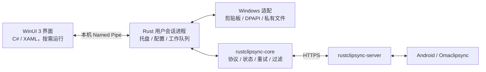

# Windows 客户端设计

状态：设计已选定；共享 Rust 核心已在本机抽取并接入 Omaclipsync，Windows Rust 后台与平台适配已有源码实现，WinUI 页面尚未实现；验证范围见 VALIDATION.md。

## 目标与技术选择

面向 Windows 11，首发 x64，随后评估 ARM64。文本同步复用现有服务端协议，默认不保存历史、不同步已标记敏感内容。优先保证不回放旧内容、不形成复制回环和低空闲资源占用；先不加入图片、文件、旧 SyncClipboard 协议或端到端加密。

UI 使用 WinUI 3、C# 和 XAML。它提供原生 Fluent 控件，适合设置、列表、系统主题与无障碍交互。Windows App SDK 和 .NET 的具体受支持版本在实现时锁定，不在设计阶段猜测版本或内存收益。[微软 WinUI 文档](https://learn.microsoft.com/en-us/windows/apps/winui/winui3/)

Rust 负责同步和系统交互，通过 Microsoft windows-rs 的低层 `windows-sys` 绑定调用 Win32。UI 不承载常驻同步状态，也不直接调用服务端。先使用两个进程和 Named Pipe，避免把 C ABI、Rust 生命周期及 .NET 常驻内存耦合在一起。NativeAOT 属于后续可测量的优化，不是首发前提。

## 进程与模块



| 部分 | 所有权和职责 |
| --- | --- |
| Rust agent | 唯一的同步状态持有者；监听剪贴板、托盘、暂停/恢复、启动 UI、调度网络、写入状态 |
| WinUI | 展示状态、修改设置、历史/收件箱操作、配对输入和错误反馈；关闭后真正结束 UI 进程 |
| 共享核心 | HTTP DTO、HTTPS 客户端、epoch/revision、outbox、幂等重试、接收游标、加密状态编码、长轮询 |
| Windows adapter | Win32 剪贴板、事件标记、DPAPI、文件 ACL/原子替换、Named Pipe 和会话生命周期 |

agent 以普通用户运行，不是 SYSTEM 服务，不要求管理员权限。网络和状态机在串行工作队列执行；窗口消息线程保持响应，UI 用异步 IPC。长轮询可以使用核心自己的线程，事件合并后唤醒同步队列。关闭 agent 时停止接收新操作，持久化待办，再取消/等待有界的网络操作。

每个用户配置只允许一个状态写入者，以状态文件排他锁防止重复进程。Pipe 名包含用户与会话标识，ACL 绑定当前登录会话；同一用户的第二个同时登录会话不得争用同一设备身份，首发给出“该配置正在另一会话使用”的明确状态。RDP 重新连接同一会话不产生新设备身份。

建议后续目录：

```text
rustclipsync-destop/
  agent/                    Rust 可执行程序和 Windows 平台适配
  ui/                       WinUI 3 C#/XAML 项目
  contracts/                IPC schema、DTO 样例和契约测试
  tests/                    Windows 自动化及跨客户端集成测试
  packaging/                安装、升级、签名和卸载脚本
```

目前已建立 `agent/`、Windows 测试与 CI，其他目录在对应实施阶段创建。

## 共享核心的消费方式

`rustclipsync-core` 是独立 Rust 库，而非把 Omaclipsync 整个 daemon 搬到 Windows。它的 `Clipboard`、`StateStore`、`HistorySink` 和 `Transport` 是平台边界。Windows 实现前三个接口，正常网络使用核心内置 HTTPS transport。

目前 Omaclipsync 使用带逐文件 SHA-256 的自动导出快照，保持独立检出和源码包可编译；同步逻辑只在共享库修改。共享库正式发布后，两端统一固定版本或提交，禁止跟随浮动主分支。共享库版本与 Windows、Android、服务端产品版本分离。Android 首期不引入 JNI，使用协议契约及跨客户端测试保证一致性。

本轮保留 Omaclipsync 的状态路径、密钥环账户、加密格式、敏感策略与确认语义。现有源码中的旧模块未在本次抽取中全面清理，旧传输实现没有进入共享库。

## 同步行为与防重复

以 [现有 HTTP 协议](https://github.com/Infinifar/rustclipsync-server/blob/main/PROTOCOL-V1.md) 为准：

1. 一次真实复制生成一个随机 UUID；网络重试使用同一个 UUID，不能重新生成。
2. revision 决定服务端顺序，epoch 区分服务端状态世代。时间戳只做过期校验，不使用“时间戳加三位随机数”作为唯一性或排序依据。
3. 离线保留最后一条尚未发送内容。请求结果未知时，保留原始请求，确认或取消后再发送最后一条新内容；并非维护无限离线队列。
4. 接收先检查设备、epoch 和游标，抓取正文后复查最新服务端状态与本地复制序号。用户在下载中复制了新内容，立即放弃本次系统剪贴板写入。
5. 在外部写入前保存 applying 日志；成功后保存 cursor/ack。确认可重试。崩溃后无法确认是否已写入时消费为 skipped，优先避免旧内容重放，允许极端情况下漏一次接收。
6. 写入剪贴板携带应用自己的来源格式与消息 ID，监听器识别本次回声，不再创建上传。marker 仅用于回环抑制，不能当作可信身份认证。
7. 本机清空只撤销本地待发送项，不清空服务端，也不重放已消费的最后一条。用户重新复制同一正文是新事件，不等同于网络重复投递。
8. 409 冲突保留本地意图并提示用户选择；自动流程不静默改变 base revision 覆盖另一台设备。

不能承诺 OS 剪贴板副作用 exactly-once，也不能仅靠服务端实现防回环。持久化游标和本地事件来源都必须由客户端参与维护。

## Windows 剪贴板适配

使用隐藏消息窗口和 `AddClipboardFormatListener` 接收 `WM_CLIPBOARDUPDATE`；用 `GetClipboardSequenceNumber` 识别本机变化。它不是跨设备版本号，允许绕回，不能与服务端 revision 比较。启动时只建立基线，不上传已有剪贴板。[Win32 剪贴板文档](https://learn.microsoft.com/en-us/windows/win32/dataxchg/using-the-clipboard)

首发仅支持 `CF_UNICODETEXT`。做有界 UTF-16 读取和 UTF-8 编码检查，编码后最大 10 MiB；空值、非文本、非法编码分别处理。`OpenClipboard` 被占用时做短时间有限重试，不阻塞消息线程；超过期限报告失败。关闭剪贴板后才进行网络 I/O。

远端写入前，再次取得剪贴板访问权并复查序号，尽量缩小检查与写入之间的竞态；保存核心日志及正文后，按照 Win32 所有权规则交付内存。部分写入失败必须返回错误，让应用日志恢复处理，不能先发送 applied。

来源格式使用注册的私有名称（例如 `RustClipSync.MessageId`），不要解析正文添加隐形字符串。操作系统历史/云剪贴板排除格式与常见密码管理器标记在 Windows 测试中逐项验证；这些是应用提示，并不能识别所有敏感数据。

## 敏感内容和历史

设置文案统一为：

> 同步已标记的敏感文本
>
> 默认关闭。部分应用可能不标记敏感内容，因此不能识别所有敏感信息。

默认关闭时不上传标记敏感内容，收到这类消息不写剪贴板并确认 skipped。Windows 的目标交互是在用户启用敏感同步后，让收到的敏感内容进入应用私有收件箱，由用户明确点击复制，不自动覆盖系统剪贴板；关闭长期历史仍可使用当前收件项。

这个目标需在下一阶段显式扩展共享核心的接收落点，目前抽取版本的 `Clipboard::write` 成功仍表示写入系统剪贴板。不能把私有收件箱适配成“假成功”。建议保持现有服务器协议：私有收件项及消费游标在一次加密状态提交中保存，服务器确认使用 skipped（有意未写系统剪贴板），客户端另记落点为 inbox；用户点击复制是明确本地操作。这一行为必须先补核心契约测试，再接入 Windows UI。

长期历史默认关闭；打开后默认保留 7 天，可设置天数，并设置条数与总字节双重上限。单独提供“清空历史”，不重置同步游标或设备身份。历史正文加密，日志不保存正文；清理以逻辑删除/密钥销毁为边界，不承诺 SSD 上物理擦除。

本轮不改变 Linux 上现有敏感内容体验；实际源码中，启用同步时写入 Wayland 剪贴板并附带敏感标记，桌面历史/应用是否显示它取决于其处理方式。Windows 的私有收件箱是明确的新产品行为。

## 凭据与本地数据

设备注册使用服务端账户密码，日常同步使用独立设备 token。Windows 目标是配对后不持久保存账户密码，重新配对再输入；现有核心 Client 仍持有构造时的配对密码，实现 Windows 配对流程时补充短期凭据注入/释放接口，不能在文档中冒充已经实现。

随机状态加密密钥由 DPAPI CurrentUser 保护；核心使用 AES-256-GCM 加密设备 token、pending 文本和游标，沿用现有格式。Windows 文件存储放在 `%LOCALAPPDATA%\RustClipSync\`，显式限制 ACL，并实现可靠原子替换和恢复。历史使用独立加密存储，密钥可由同一受保护主密钥派生。[DPAPI 文档](https://learn.microsoft.com/en-us/windows/win32/api/dpapi/nf-dpapi-cryptprotectdata)

DPAPI 不防同一用户权限的恶意软件。TLS 保护传输，服务端依然能够读取内容；端到端加密不在首发范围。诊断导出只含固定事件、错误码、版本和耗时，不含正文、密码、token 或 HTTP Authorization。

## 原生页面

使用系统 `NavigationView` 分为四页。遵循系统字体、浅深色与高对比主题；Mica 在支持的情况下启用，其他环境使用实色背景。统一键盘访问、自动化名称、缩放和屏幕阅读器支持。

| 页面 | 内容与操作 | 控件建议 |
| --- | --- | --- |
| 同步 | 连接状态、服务端地址、设备名、最近收发时间、暂停/恢复、手动发送/接收、冲突处理 | 状态文本、Button、ToggleSwitch、InfoBar、ContentDialog |
| 收件箱与历史 | 当前私有收件项；可选长期历史；复制、删除、清空；正文按需展开、敏感内容默认遮挡 | 虚拟化 ListView、搜索框、ContentDialog |
| 设置 | HTTPS 地址、账户配对、设备重配、同步方向、敏感开关、文本过滤、历史期限、开机启动、主题 | PasswordBox、TextBox、ComboBox、ToggleSwitch、NumberBox |
| 关于与诊断 | 应用和核心版本、服务端/Android/Linux 项目链接、许可证、脱敏诊断导出 | HyperlinkButton、TextBlock、Button |

托盘只保留打开窗口、暂停/恢复、当前状态、退出等少量动作。关闭窗口继续同步，托盘“退出”结束整个应用；关闭前的说明只在首次出现。禁用自动启动不等于暂停当前会话。断网、凭据失效、设备撤销、冲突、存储错误必须显示不同状态，避免一律显示“连接失败”。

## 安装与性能

首发优先做按用户安装的签名 MSIX，并在最早打包实验中验证 WinUI 运行时、Rust 完全信任进程、托盘及可选登录启动能共同工作。若 MSIX 的生命周期限制影响后台进程，再评估签名的普通安装包；不要在核心设计中绑定某一种打包 API。升级必须退出旧 agent 后替换文件，并保留配置、身份与游标；卸载数据清理需明确选择。

性能验收分开测 agent 空闲、UI 打开、关闭 UI 后、网络失败、长文本峰值与长时间运行。只在 Windows 实机或虚拟机上给出数值，不把 Linux 二进制大小或内存数据当作 Windows 结果。主要优化来自 UI 按需退出、事件驱动、有界队列和文本副本限制。

参考实现入口：[Microsoft windows-rs](https://github.com/microsoft/windows-rs)。上述进程和模块划分是本项目设计决策，不是微软对该应用资源用量的保证。
